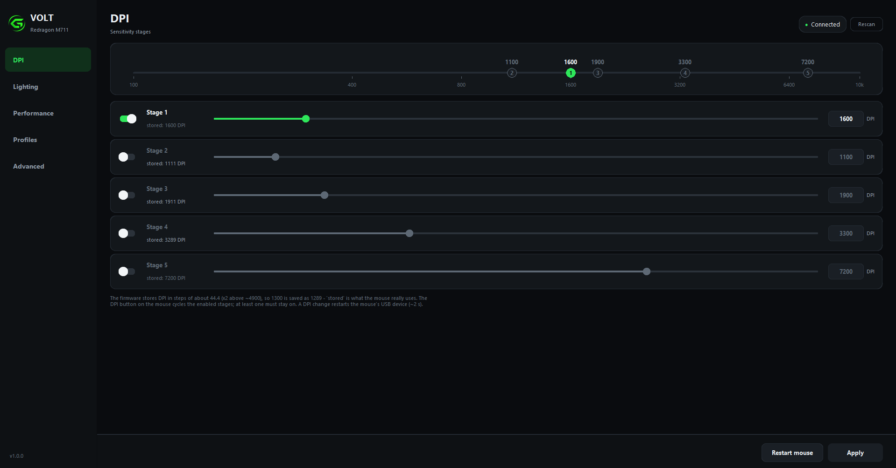
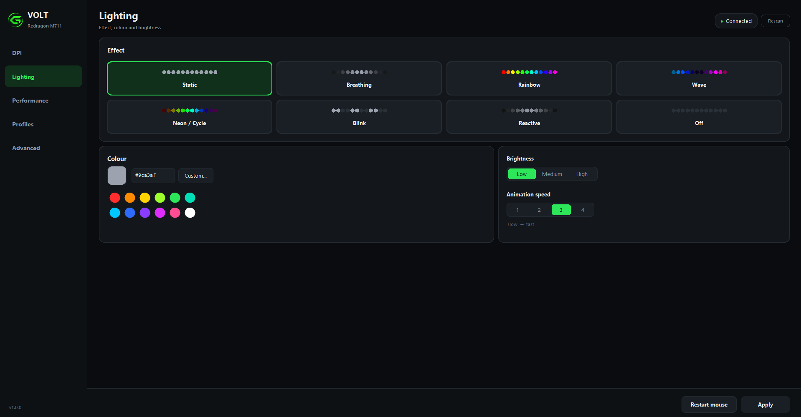
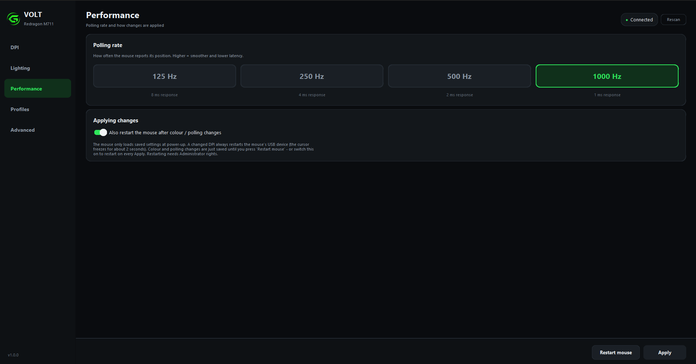

# VOLT

**A small, modern configurator for the Redragon M711 Cobra / RD-S131 mouse on Windows.**
Change DPI stages, lighting and polling rate without Redragon's official software, which doesn't work on many systems.



<p align="center">
  
  
</p>

## Features
- **DPI:** 5 stages from 100 to 10000, each with its own toggle, slider and number entry
- **Lighting:** effect, colour (swatches, hex or picker), brightness and speed
- **Polling rate:** 125 / 250 / 500 / 1000 Hz
- **Profiles and backups:** 5 profiles, automatic backup before every Apply, restore any backup
- **Advanced:** HID endpoint picker, memory dump, LED recovery, debug log
- Portable: no installer, no account, no network access

## Requirements
- **Windows 10 (version 1903 or newer) or Windows 11.** The current version supports Windows only; Linux and macOS are not supported.
- A **Redragon M711 Cobra / RD-S131** mouse (`04D9:FC30`).
- Administrator rights, for restarting the mouse (see below).

## Download
Get the `.exe` from the [Releases](https://github.com/nasedev901/VOLT/releases) page and run it. No unzipping and no install.
Windows asks for Administrator rights on every start (see [Why admin?](#why-administrator-and-why-does-the-mouse-restart)).

Some antivirus engines flag PyInstaller programs that ask for admin and run PowerShell. If that happens, the full source is in this repo, and you can [build it yourself](https://github.com/nasedev901/VOLT/blob/main/BUILD.md) or run it from source.

## Run from source
```
py -m pip install customtkinter hidapi Pillow
py volt.py
```
Start it in an Administrator terminal if you want the restart feature. Use `py volt.py --dry-run` to try the whole interface without sending anything to the mouse.

| Option | What it does |
|---|---|
| `--dry-run` | Full GUI, nothing is sent to the mouse |
| `--debug` | List the mouse's HID interfaces |
| `--probe` | Read-only check and profile dump |
| `--dump` | Read-only memory dump to a text file |

## Why Administrator, and why does the mouse restart?
This mouse only loads its saved settings at power-up. VOLT writes your settings to the mouse's flash memory, then restarts the mouse's USB device (about 2 seconds, the cursor freezes briefly) so they take effect. Windows only allows that restart with Administrator rights. There is no live-update command, so a restart is the only way.

- A **DPI change** always restarts the mouse.
- **Colour and polling changes** are saved first. Press **Restart mouse** to load them, or turn on *Also restart the mouse after colour / polling changes* on the Performance page.

## Compatibility
| Mouse | Status |
|---|---|
| Redragon M711 / RD-S131 (`04D9:FC30`) | Tested: DPI, polling rate, Static / Breathing / Off, brightness, speed |
| Same mouse, other effects (Rainbow, Wave, Neon / Cycle, Blink, Reactive) | Untested, reports welcome |
| Any other mouse | Not supported. Do NOT use VOLT on other hardware |

| System | Status |
|---|---|
| Windows 10 (1903+) / Windows 11 | Supported |
| Linux, macOS | Not supported |

## Safety
VOLT is unofficial and not affiliated with Redragon. It writes to your mouse's flash memory. Large DPI jumps could hang the mouse in testing; VOLT writes them in safe steps and restarts the mouse to recover. If the mouse ever freezes, unplug and replug it. A backup is saved to `%APPDATA%\RedragonM711` before every Apply.

## Uninstall
Delete `VOLT.exe`. To remove backups and settings too, delete `%APPDATA%\RedragonM711`. Your mouse keeps its settings; use *Restore backup* first if you want your old ones back.

## Troubleshooting
- **"Not connected":** close the official Redragon software, replug the mouse and press *Rescan*.
- **Restart failed:** make sure VOLT was started as Administrator.
- **Window does not open:** check `%APPDATA%\RedragonM711\volt-crash.log`.

## Reporting a bug
Open an issue and include your Windows version, what you did, what you expected, and the output of `py volt.py --probe`. A copy of the log from *Advanced > Debug log* helps a lot.

Before pasting logs, remove the `path=` lines. They contain your device's unique USB ID.

## Contributing
Pull requests are welcome, especially reports and fixes for the untested lighting effects. Run the tests before opening one:
```
py -m unittest discover -s tests
```
The tests use a simulated mouse, so no hardware is needed.

## Credits
Created by **nase**.

The mouse protocol knowledge builds on earlier reverse-engineering work:
[mouse_m908](https://github.com/dokutan/mouse_m908) (GPL-3.0-or-later), [usb-mouse-config](https://github.com/ernesto-elsaesser/usb-mouse-config) and [m711-port](https://github.com/SK2674/m711-port).

## License
Copyright (C) 2026 nase

VOLT is free software under the **GNU General Public License v3.0** (see [LICENSE](https://github.com/nasedev901/VOLT/blob/main/LICENSE)).
You may use, share and modify it, but you must keep the copyright notice and credit the author, and any version you distribute must stay open source under the same license.
